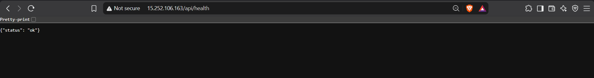
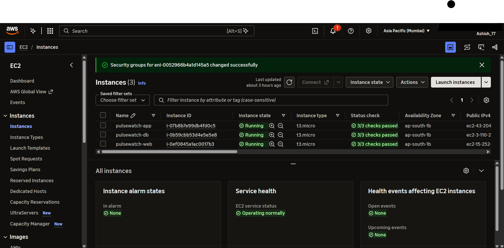

# PulseWatch — 3‑Server AWS Deployment

PulseWatch is a lightweight server‑monitoring dashboard. A web frontend displays
live CPU, memory and disk gauges, a historical chart and an alerts panel; a
backend API collects metrics and stores them in PostgreSQL.

This repository documents **my deployment** of the upstream project
([Ashish7738/pulsewatch](https://github.com/Ashish7738/pulsewatch)) across
**three separate AWS EC2 instances**, built and deployed by a **Jenkins CI/CD
pipeline**.

---

## Table of contents

1. [Architecture](#architecture)
2. [Tech stack](#tech-stack)
3. [Repository layout](#repository-layout)
4. [AWS infrastructure](#aws-infrastructure)
5. [Security groups](#security-groups)
6. [Environment file](#environment-file)
7. [Jenkins setup](#jenkins-setup)
8. [CI/CD pipeline](#cicd-pipeline)
9. [Deployment walkthrough](#deployment-walkthrough)
10. [Accessing the application](#accessing-the-application)
11. [Screenshots / evidence](#screenshots--evidence)
12. [Troubleshooting log](#troubleshooting-log)
13. [Security notes](#security-notes)
14. [Teardown](#teardown)

---

## Architecture

```
                     ┌─────────────────────────────────────────────┐
   Browser           │  EC2: pulsewatch-web   (public subnet)      │
  http://…:80  ────► │  ┌───────────────────────────────────────┐  │
                     │  │ container: pulsewatch-web-frontend-1  │  │
                     │  │ nginx + static frontend, :8080 → host │  │
                     │  └───────────────────┬───────────────────┘  │
                     │                      │ /api proxy           │
                     │  ┌───────────────────▼───────────────────┐  │
                     │  │ Jenkins (controller, :8080)           │  │
                     │  └───────────────────────────────────────┘  │
                     └──────────────────────┬──────────────────────┘
                                            │ private IP :5000
                     ┌──────────────────────▼──────────────────────┐
                     │  EC2: pulsewatch-app   (private)            │
                     │  container: pulsewatch-app-backend-1        │
                     │  Flask API + metrics collector, :5000       │
                     └──────────────────────┬──────────────────────┘
                                            │ private IP :5432
                     ┌──────────────────────▼──────────────────────┐
                     │  EC2: pulsewatch-db    (private)            │
                     │  container: pulsewatch-db-db-1              │
                     │  PostgreSQL 16, volume pulsewatch-db_pgdata │
                     └─────────────────────────────────────────────┘
```

Only the **web** instance has a public IP. All service‑to‑service traffic
(`web → app`, `app → db`) uses **private IPs** inside the VPC and is authorised
by **security‑group references**, not CIDR ranges.

| Tier | Instance | Private IP | Container | Port |
|------|----------|------------|-----------|------|
| Web / CI | `pulsewatch-web` | `172.31.7.40` | `pulsewatch-web-frontend-1` | 80 → 8080 |
| App | `pulsewatch-app` | `172.31.9.102` | `pulsewatch-app-backend-1` | 5000 |
| DB | `pulsewatch-db` | `172.31.7.4` | `pulsewatch-db-db-1` | 5432 |

---

## Tech stack

- **Frontend:** static SPA served by nginx in the web container
- **Backend:** Python / Flask API with a metrics collector, health endpoint `/api/health`
- **Database:** PostgreSQL 16 (`postgres:16-alpine`), persisted on a named Docker volume
- **Containerisation:** Docker Engine + Docker Compose (three separate compose files)
- **CI/CD:** Jenkins (declarative pipeline, `Jenkinsfile` in repo root)
- **Cloud:** AWS EC2 (Ubuntu), custom security groups, EBS root volumes

---

## Repository layout

```
pulsewatch/
├── backend/                    # Flask API + Dockerfile
├── frontend/                   # static UI
├── nginx/                      # nginx reverse‑proxy config
├── screenshots/                # evidence images used in this README
├── docker-compose.web.yml      # frontend (+ reverse proxy)  — runs on web
├── docker-compose.app.yml      # backend API                 — runs on app
├── docker-compose.db.yml       # PostgreSQL                  — runs on db
├── Jenkinsfile                 # 5‑stage declarative pipeline
├── .env.example                # template for .env (never commit .env)
└── README.md
```

---

## AWS infrastructure

Three Ubuntu instances in the same VPC / subnet:

| Instance | Role | Public IP | Notes |
|----------|------|-----------|-------|
| `pulsewatch-web` | Frontend + Jenkins | **yes** (Elastic IP recommended) | Jenkins on `:8080`, site on `:80` |
| `pulsewatch-app` | Backend API | no | reachable only from `pulsewatch-web` |
| `pulsewatch-db`  | PostgreSQL | no | reachable only from `pulsewatch-app` |

**Instance sizing notes (learned the hard way):**

- A 1 GB `t3.micro` is **too small** for Jenkins + a Docker build. At minimum:
  - **2 GB swap** on the web host, and
  - Jenkins JVM heap capped: `JAVA_ARGS="-Djava.awt.headless=true -Xmx512m -Xms256m"` in `/etc/default/jenkins`.
- Root EBS volumes should be **≥ 20 GiB** on the web host (Docker layers + build cache fill 8 GiB almost immediately).
- `/tmp` is a RAM‑backed tmpfs sized at 50 % of RAM. Jenkins takes its node **offline** when free `/tmp` drops below **1 GiB**. On small instances either enlarge the tmpfs (`size=1G` in `/etc/fstab`) **or** lower the node's *Free Temp Space Threshold* in Jenkins (Manage Jenkins → Nodes → Built‑In Node → Configure → Disk Space Monitoring).

---

## Security groups

All three groups allow **All traffic outbound to `0.0.0.0/0`** (needed to pull Docker
images). Inbound rules:

### `pulsewatch-web`

| Type | Protocol | Port | Source |
|------|----------|------|--------|
| SSH | TCP | 22 | My IP |
| HTTP | TCP | 80 | 0.0.0.0/0 |
| Custom TCP | TCP | 8080 | My IP |

### `pulsewatch-app`

| Type | Protocol | Port | Source |
|------|----------|------|--------|
| SSH | TCP | 22 | My IP |
| SSH | TCP | 22 | Custom → `pulsewatch-web` |
| Custom TCP | TCP | 5000 | Custom → `pulsewatch-web` |

### `pulsewatch-db`

| Type | Protocol | Port | Source |
|------|----------|------|--------|
| SSH | TCP | 22 | My IP |
| SSH | TCP | 22 | Custom → `pulsewatch-web` |
| Custom TCP | TCP | 5432 | Custom → `pulsewatch-app` |

> **Note:** if your IP changes, re‑select **My IP** on the SSH and 8080 rules —
> a stale rule is the most common cause of "Jenkins was working yesterday".

---

## Environment file

`~/pulsewatch/.env` on **pulsewatch-web** (template: `.env.example`). Never commit it.

```dotenv
# openssl rand -hex 16
DB_PASSWORD=<32-hex-chars>
# openssl rand -hex 32
JWT_SECRET=<64-hex-chars>

# private IPs of the other two instances
APP_HOST=172.31.9.102
DB_HOST=172.31.7.4
```

This file is uploaded to Jenkins as the **`pulsewatch-env`** credential of kind
**Secret file** and bound into the pipeline via `withCredentials`. Re‑upload it
every time the file changes — the credential is a snapshot.

---

## Jenkins setup

1. Install Jenkins on `pulsewatch-web` (`:8080`).
2. Let the `jenkins` user use Docker:
   ```bash
   sudo usermod -aG docker jenkins
   sudo systemctl restart jenkins
   ```
3. Give the `jenkins` user SSH access to the app and db hosts:
   ```bash
   sudo -u jenkins ssh-keygen -t ed25519 -f /var/lib/jenkins/.ssh/id_ed25519 -N ""
   sudo cat /var/lib/jenkins/.ssh/id_ed25519.pub   # append to ubuntu@APP/DB:~/.ssh/authorized_keys
   sudo -u jenkins ssh-keyscan -H $APP_HOST $DB_HOST | sudo tee -a /var/lib/jenkins/.ssh/known_hosts
   ```
4. Create credential **Kind = Secret file**, **ID = `pulsewatch-env`**, file = `.env`.
   > The ID field is hidden behind **Advanced…** — leaving it blank makes Jenkins
   > default to the filename (`pulsewatch.env`), which will never match
   > `credentials('pulsewatch-env')`.
5. Pipeline job: **Pipeline script from SCM** → Git → repo URL → branch `main` → script path `Jenkinsfile`.

---

## CI/CD pipeline

`Jenkinsfile` defines five stages (agent `any`, runs on the built‑in node):

| Stage | What it does |
|-------|--------------|
| **Checkout** | `checkout scm` |
| **Lint & Test** | builds `backend/Dockerfile` as `pulsewatch-test`, runs `flake8` + `pytest -q` inside |
| **Build** | `docker compose build` for web locally and for app over `DOCKER_HOST=ssh://ubuntu@$APP_HOST` |
| **Deploy** | brings up db on `$DB_HOST` (`--wait`), recreates app on `$APP_HOST` (`--wait`), recreates web locally |
| **Health Check** | retries `curl http://$APP_HOST:5000/api/health` and `curl http://localhost/api/health` up to 6× |

Post actions: success message, failure message, `docker image prune -f`.
Build history capped at 10 (`buildDiscarder`), concurrent builds disabled.

---

## Deployment walkthrough

```bash
# 1. On the web server
git clone https://github.com/Ashish7738/pulsewatch.git
cd pulsewatch
cp .env.example .env && nano .env        # fill DB_PASSWORD, JWT_SECRET, APP_HOST, DB_HOST

# 2. Docker on all three hosts
sudo apt-get update && sudo apt-get install -y docker.io docker-compose-v2 git

# 3. Jenkins credential + pipeline job (see above)

# 4. Run
#    Jenkins → pulsewatch job → Build Now
```

Expected console tail:

```
Container pulsewatch-db-db-1 Healthy
Container pulsewatch-app-backend-1 Healthy
Container pulsewatch-web-frontend-1 Started
+ curl -f http://172.31.9.102:5000/api/health   → {"status": "ok"}
+ curl -f http://localhost/api/health            → {"status": "ok"}
PulseWatch deployed on 3 servers
Finished: SUCCESS
```

---

## Accessing the application

| What | URL |
|------|-----|
| **PulseWatch UI** | `http://<WEB_PUBLIC_IP>/` |
| **API docs (Swagger)** | `http://<WEB_PUBLIC_IP>/api/docs` |
| **Jenkins** | `http://<WEB_PUBLIC_IP>:8080/` |
| Health endpoints | `http://172.31.9.102:5000/api/health`, `http://localhost/api/health` |

Register a user on the login page, then the dashboard streams live CPU / memory /
disk gauges, a historical chart, a **System info** card (OS + EC2 hostname) and an
alerts panel.

---

## Screenshots / evidence

All images live in [`screenshots/`](screenshots). Sensitive values
(public IPs, email, AWS account ID, key name, tokens) are blurred.

| # | File | Captured | What it proves |
|---|------|----------|----------------|
| 1 | [`01-login.png`](screenshots/01-login.png) | After the first green Jenkins build, browser logged out | The PulseWatch login form is served from the EC2 web host |
| 2 | [`02-dashboard.png`](screenshots/02-dashboard.png) | ~3 min after registering | Live data end‑to‑end: three gauges, line chart, System info card (Ubuntu + EC2 hostname), alerts panel |
| 3 | [`03-swagger-api.png`](screenshots/03-swagger-api.png) | Same session | The backend API is reachable through the web tier at `/api/docs` |
| 4 | [`04-jenkins-pipeline.png`](screenshots/04-jenkins-pipeline.png) | Immediately after a successful **Build Now** | Stage View: Checkout, Lint & Test, Build, Deploy, Health Check — all green |
| 5 | [`05-docker-ps.png`](screenshots/05-docker-ps.png) | On the server (`docker ps`) | All three containers `Up`, with `db` and `backend` **healthy** |
| 6 | [`06-ec2-console.png`](screenshots/06-ec2-console.png) | AWS Console → EC2 → Instances | The instances in state **Running** |

### Screenshot 1 — Login


### Screenshot 2 — Dashboard


### Screenshot 3 — Swagger / API docs


### Screenshot 4 — Jenkins Stage View


### Screenshot 5 — `docker ps` on the server


### Screenshot 6 — EC2 instances running


---

## Troubleshooting log

Issues hit during this deployment and how they were resolved — kept here so the
next person doesn't rediscover them.

| Symptom | Cause | Fix |
|---------|-------|-----|
| Jenkins node **offline**: "Disk space is below threshold of 1.00 GiB … /tmp" | `/tmp` is a tmpfs of ~455 MiB on a 1 GB instance — it can never reach 1 GiB | Either `mount -o remount,size=1G /tmp` **or** lower the node's Free Temp Space Threshold to `0.5` GiB (Manage Jenkins → Nodes → Built‑In Node → Configure) |
| `mount: fstab has been modified, but systemd still uses the old version` | systemd caches mount units | `sudo systemctl daemon-reload && sudo mount -o remount /tmp` |
| Build queued forever: "Waiting for next available executor" | Node offline (disk threshold) or quiet mode | Restore node Online, cancel quiet mode, abort stale builds |
| `ERROR: pulsewatch-env` at end of build, plus `MissingContextVariableException: hudson.FilePath is missing` | Credential ID mismatch — the credential was created as `pulsewatch.env` (dot) instead of `pulsewatch-env` (hyphen). The `FilePath` error is only fallout because the pipeline aborts before allocating an agent | Delete and recreate the credential with **ID `pulsewatch-env`** typed manually under **Advanced…**; or bind it with `withCredentials([file(credentialsId: 'pulsewatch-env', variable: 'ENV_FILE')])` instead of the top‑level `environment` block |
| `docker build` killed / instance unresponsive | 908 MiB RAM, 0 swap | Add 2 GiB swap (`fallocate` + `mkswap` + `swapon`, persist in `/etc/fstab`), cap Jenkins heap at `-Xmx512m`, resize instance to `t3.small`+ |
| `no space left on device` during Build | 8 GiB root volume | Grow EBS to 20 GiB (`growpart` + `resize2fs`), prune with `docker system prune -af` |
| `permission denied … /var/run/docker.sock` in pipeline | `jenkins` not in `docker` group | `sudo usermod -aG docker jenkins && sudo systemctl restart jenkins` |
| Deploy stage hangs on `DOCKER_HOST=ssh://…` | `jenkins` has no key for app/db, or unknown host key | `sudo -u jenkins ssh-keygen …`, append pubkey to targets, `ssh-keyscan >> known_hosts` |
| `ssh ubuntu@172.31.9.102 "docker ps"` → `Permission denied (publickey)` | The `ubuntu` user has no key on the app/db hosts — only the `jenkins` user does | Run `sudo -u jenkins ssh ubuntu@172.31.9.102 "docker ps"` (that's what the pipeline does) |
| Health check 000/refused | web compose publishes `80:8080`; app publishes `5000:5000` — mismatch breaks the curl | Confirm `docker-compose.web.yml` maps `"80:8080"` and `docker-compose.app.yml` maps `"5000:5000"` |
| Jenkins page unreachable from browser | SG rule for 8080 was scoped to "My IP" and the IP changed | Re‑apply **My IP** on the 8080 rule |
| Screenshots render as broken images on GitHub | Files named `05-docker-ps.png.png` / `06-ec2-console.png.png` (double extension) or in the wrong folder | `Rename-Item screenshots\05-docker-ps.png.png screenshots\05-docker-ps.png` (same for 06) |

---

## Security notes

- **`.env` is never committed.** Only `.env.example` is in the repo.
- **Rotate secrets** if they ever appear in a build log, shell history or chat.
  ```bash
  sed -i "s/^DB_PASSWORD=.*/DB_PASSWORD=$(openssl rand -hex 16)/" .env
  sed -i "s/^JWT_SECRET=.*/JWT_SECRET=$(openssl rand -hex 32)/" .env
  ```
  then re‑upload the credential. Changing `DB_PASSWORD` on an already‑initialised
  Postgres volume requires `docker compose -f docker-compose.db.yml down -v` on the
  db host so the cluster re‑initialises.
- Jenkins `sh` steps echo commands; sourcing a file containing secrets prints them.
  Start each secret‑touching `sh` block with `set +x`, or pass values via
  `withCredentials` bindings rather than `set -a; . "$ENV_FILE"`.
- Only port 80 is exposed to `0.0.0.0/0`. Jenkins `:8080` and SSH are restricted to
  **My IP**. The app and db tiers have **no public IP** at all.
- Prefer an Elastic IP for the web instance so the URL survives a stop/start.

---

## Teardown

```bash
# on each host
docker compose -f docker-compose.<tier>.yml down            # keep volumes
docker compose -f docker-compose.<tier>.yml down -v         # delete DB data

# then in AWS
# EC2 → Instances → terminate all three
# EC2 → Volumes → delete orphaned volumes
# EC2 → Security Groups → delete pulsewatch-*
```

---

## Credits

Upstream project: [Ashish7738/pulsewatch](https://github.com/Ashish7738/pulsewatch).
This README documents a three‑server AWS deployment of that codebase with a
Jenkins build/deploy pipeline.
