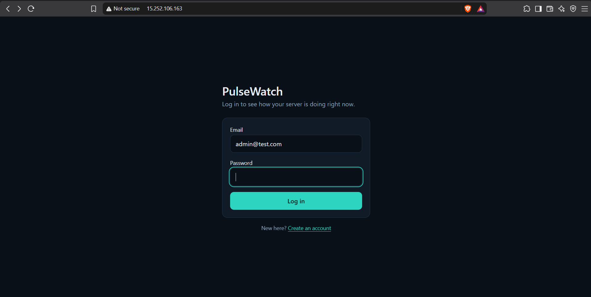
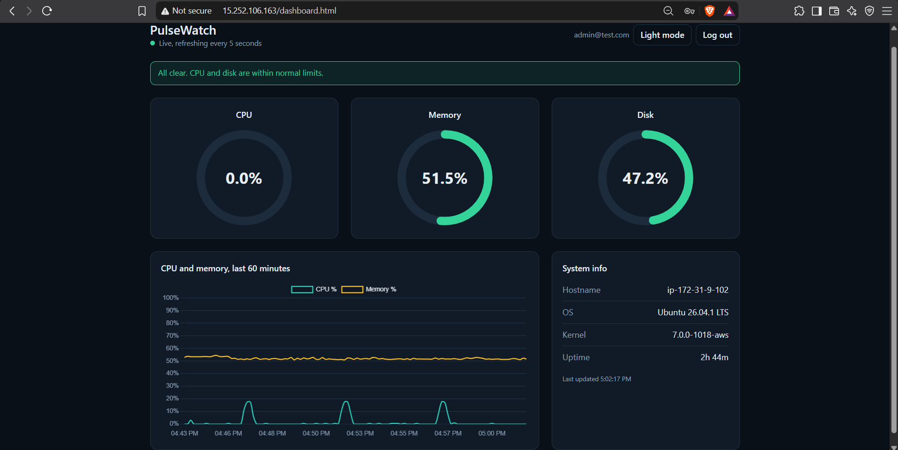
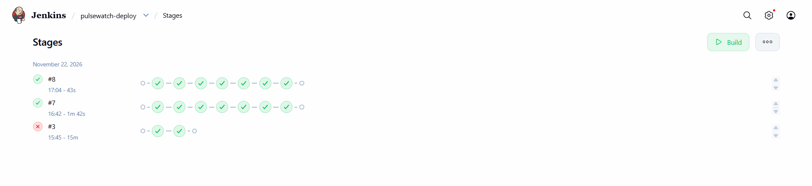
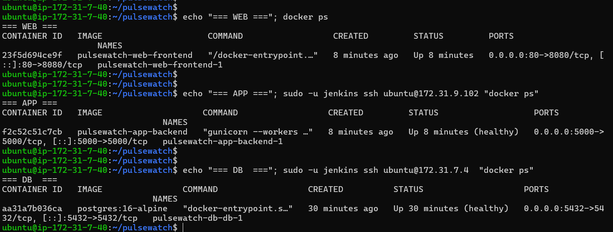

# PulseWatch

> A self-hosted dashboard that shows live CPU, memory and disk usage of the server it runs on, deployed to AWS EC2 with Docker Compose and shipped by a Jenkins pipeline.


## 📸 Live Demo Proof

<table>
  <tr>
    <td align="center"><br><sub>Login page</sub></td>
    <td align="center"><br><sub>Dashboard: gauges, history chart, system info</sub></td>
  </tr>
  <tr>
    <td align="center"><br><sub>Swagger UI at <code>/api/docs</code></sub></td>
    <td align="center"><br><sub>Jenkins pipeline, all stages green</sub></td>
  </tr>
  <tr>
    <td align="center"><br><sub><code>docker ps</code> on EC2: 3 containers running</sub></td>
    <td align="center"><br><sub>AWS console: instance <em>running</em></sub></td>
  </tr>
</table>

> **Before you commit screenshots:** blur public IPs, JWT tokens, your AWS account ID, and any email addresses you do not want public.

## Architecture

```
                         AWS EC2 (Ubuntu 22.04)
 ┌───────────────────────────────────────────────────────────────────┐
 │  Docker Compose                                                   │
 │                                                                   │
 │  Browser ──:80──► ┌─────────┐  /api/*  ┌──────────────┐  ┌──────┐ │
 │                   │  Nginx  │─────────►│ Flask +      │─►│ Post │ │
 │                   │ (static)│          │ Gunicorn:5000│  │ gres │ │
 │                   └─────────┘          │ + psutil     │  │  16  │ │
 │                                        │   sampler    │  └──────┘ │
 │                                        └──────────────┘  pgdata   │
 │                                                                   │
 │  Jenkins :8080 ── docker compose build + up ──► (stack above)     │
 └───────────────────────────────────────────────────────────────────┘
```

## Features

- JWT authentication: register (auto-login) and login
- Three animated gauges for CPU, memory and disk, refreshed every 5 seconds
- Chart.js line chart of CPU and memory for the last 60 minutes (refreshed every 30 seconds)
- System info card: hostname, OS, kernel version, uptime
- Alerts: yellow warning when CPU is above 80%, red when disk is above 90%
- Background thread samples psutil every 10 seconds into PostgreSQL; rows older than 7 days are deleted automatically
- Swagger UI generated at `/api/docs`
- JSON errors for 400, 401, 404 and 500
- Dark mode by default (with a light toggle), responsive layout
- Jenkins pipeline: checkout, lint and test, build, deploy, health check

## Tech Stack

| Layer | Technology |
|---|---|
| Backend | Python 3.11, Flask, Flask-SQLAlchemy, Flask-JWT-Extended, flask-restx, psutil, Gunicorn |
| Frontend | HTML5, Tailwind CSS (CDN), vanilla JavaScript, Chart.js (CDN) |
| Database | PostgreSQL 16 |
| Reverse proxy | Nginx (unprivileged image) |
| Containers | Docker, Docker Compose (db, backend, frontend) |
| CI/CD | Jenkins (declarative Jenkinsfile) |
| Cloud | AWS EC2, Ubuntu 22.04 |

## API Endpoints

| Method | Endpoint | Auth | Description |
|---|---|---|---|
| POST | `/api/auth/register` | No | Create user, returns a JWT |
| POST | `/api/auth/login` | No | Returns a JWT |
| GET | `/api/metrics/latest` | Yes | Latest CPU / memory / disk |
| GET | `/api/metrics/history?minutes=60` | Yes | Historical samples (1 to 10080 minutes) |
| GET | `/api/system/info` | Yes | Hostname, OS, kernel, uptime |
| GET | `/api/health` | No | `{"status": "ok"}` |
| GET | `/api/docs` | No | Swagger UI |

Protected endpoints expect `Authorization: Bearer <token>`.

## Run Locally

Requires Docker with the Compose plugin.

```bash
git clone https://github.com/<your-username>/pulsewatch.git
cd pulsewatch
cp .env.example .env        # then edit DB_PASSWORD and JWT_SECRET
docker compose up --build
```

Generate good values:

```bash
openssl rand -hex 16   # DB_PASSWORD (URL-safe)
openssl rand -hex 32   # JWT_SECRET  (64 chars, minimum is 32)
```

Open <http://localhost> (Swagger at <http://localhost/api/docs>). If port 80 is taken, change `"80:8080"` in `docker-compose.yml`.

Run the tests without Docker:

```bash
cd backend && pip install -r requirements.txt && pytest -q
```

## Deploy to AWS EC2

### 1. Launch the instance
Ubuntu Server 22.04 LTS, **t3.small** recommended. For the free tier use **t2.micro** and add swap (step 3).

### 2. Security group (inbound)

| Port | Source | Purpose |
|---|---|---|
| 22 | **Your IP only** | SSH |
| 80 | 0.0.0.0/0 | PulseWatch |
| 8080 | Your IP (recommended) | Jenkins |

### 3. SSH in and (t2.micro only) add swap

```bash
ssh -i your-key.pem ubuntu@<EC2-PUBLIC-IP>

sudo fallocate -l 2G /swapfile && sudo chmod 600 /swapfile
sudo mkswap /swapfile && sudo swapon /swapfile
echo '/swapfile none swap sw 0 0' | sudo tee -a /etc/fstab
```

### 4. Install Docker, Compose and Jenkins

```bash
sudo apt-get update && sudo apt-get install -y ca-certificates curl gnupg git

# Docker Engine + Compose plugin (official repository)
sudo install -m 0755 -d /etc/apt/keyrings
curl -fsSL https://download.docker.com/linux/ubuntu/gpg | sudo gpg --dearmor -o /etc/apt/keyrings/docker.gpg
echo "deb [arch=$(dpkg --print-architecture) signed-by=/etc/apt/keyrings/docker.gpg] https://download.docker.com/linux/ubuntu $(. /etc/os-release && echo $VERSION_CODENAME) stable" | sudo tee /etc/apt/sources.list.d/docker.list
sudo apt-get update
sudo apt-get install -y docker-ce docker-ce-cli containerd.io docker-compose-plugin
sudo usermod -aG docker ubuntu

# Jenkins (needs Java 17)
sudo apt-get install -y fontconfig openjdk-17-jre
sudo wget -O /usr/share/keyrings/jenkins-keyring.asc https://pkg.jenkins.io/debian-stable/jenkins.io-2023.key
echo "deb [signed-by=/usr/share/keyrings/jenkins-keyring.asc] https://pkg.jenkins.io/debian-stable binary/" | sudo tee /etc/apt/sources.list.d/jenkins.list
sudo apt-get update && sudo apt-get install -y jenkins
```

If the Jenkins signing key has changed, copy the current commands from the Jenkins Debian install docs.

### 5. Let Jenkins use Docker

```bash
sudo usermod -aG docker jenkins
sudo systemctl restart jenkins
```

### 6. Clone the repo and create `.env`

```bash
git clone https://github.com/<your-username>/pulsewatch.git
cd pulsewatch
cp .env.example .env
nano .env     # set DB_PASSWORD and JWT_SECRET (32+ chars)
```

### 7. Set up Jenkins
1. Open `http://<EC2-PUBLIC-IP>:8080`, unlock with `sudo cat /var/lib/jenkins/secrets/initialAdminPassword`, install the suggested plugins.
2. **Manage Jenkins → Credentials → Global → Add Credentials**: kind **Secret file**, ID `pulsewatch-env`, upload your `.env`. The pipeline reads secrets from here because Jenkins builds in its own workspace, not in your clone.
3. **New Item → Pipeline**. Under *Pipeline*, choose **Pipeline script from SCM**, SCM = **Git**, enter your repo URL (add credentials if private), branch `*/main`, Script Path `Jenkinsfile`.

### 8. Deploy
Click **Build Now**. When every stage is green, open `http://<EC2-PUBLIC-IP>` and the dashboard is live. Register an account, then log in.

Useful commands on the server: `docker ps`, `docker compose logs -f backend`.

## Jenkins Pipeline Stages

| # | Stage | What it does |
|---|---|---|
| 1 | Checkout | `checkout scm` |
| 2 | Lint & Test | Builds a test image, runs `flake8` and `pytest` inside it |
| 3 | Build | `docker compose build` |
| 4 | Deploy | `docker compose down || true`, then `docker compose up -d` (the database volume is kept) |
| 5 | Health Check | Waits, then `curl -f http://localhost/api/health` with retries |

## Project Structure

```
pulsewatch/
├── backend/
│   ├── app.py                 # Flask factory, blueprint, error handlers, starts collector
│   ├── config.py              # reads DATABASE_URL, JWT_SECRET
│   ├── models.py              # User, Metric
│   ├── collector.py           # psutil background sampler + 7-day cleanup
│   ├── routes/
│   │   ├── auth.py
│   │   ├── metrics.py
│   │   └── system.py          # system info + health
│   ├── tests/test_health.py
│   ├── requirements.txt
│   └── Dockerfile
├── frontend/
│   ├── index.html             # login
│   ├── register.html
│   ├── dashboard.html
│   ├── css/style.css
│   ├── js/{api,auth,dashboard}.js
│   └── Dockerfile
├── nginx/nginx.conf
├── screenshots/               # 01-login.png ... 06-ec2-console.png
├── docker-compose.yml
├── Jenkinsfile
├── .env.example
├── .gitignore
├── .dockerignore
└── README.md
```

## What I Learned

- Wiring a multi-container app together with Compose: health checks, `depends_on` conditions and named volumes
- Why a background sampler must run in exactly one process (Gunicorn is set to one worker with threads)
- Building a declarative Jenkins pipeline and keeping secrets out of Git with Secret file credentials
- Reading host metrics from inside a container, and mounting `/etc/os-release` read-only to report the real host
- Running Nginx as a non-root user and proxying an API behind a single port

## Limitations

- Single node: no high availability, no horizontal scaling
- No HTTPS (plain HTTP on port 80); put it behind a load balancer or Let's Encrypt for real use
- Monitors one host only and has no Prometheus or Grafana integration
- JWT is kept in `localStorage`, which is simple but exposed to XSS
- No password reset, roles or rate limiting

## License

MIT. See below.

```
MIT License

Copyright (c) 2026 <your name>

Permission is hereby granted, free of charge, to any person obtaining a copy
of this software and associated documentation files (the "Software"), to deal
in the Software without restriction, including without limitation the rights
to use, copy, modify, merge, publish, distribute, sublicense, and/or sell
copies of the Software, and to permit persons to whom the Software is
furnished to do so, subject to the following conditions:

The above copyright notice and this permission notice shall be included in all
copies or substantial portions of the Software.

THE SOFTWARE IS PROVIDED "AS IS", WITHOUT WARRANTY OF ANY KIND, EXPRESS OR
IMPLIED, INCLUDING BUT NOT LIMITED TO THE WARRANTIES OF MERCHANTABILITY,
FITNESS FOR A PARTICULAR PURPOSE AND NONINFRINGEMENT. IN NO EVENT SHALL THE
AUTHORS OR COPYRIGHT HOLDERS BE LIABLE FOR ANY CLAIM, DAMAGES OR OTHER
LIABILITY, WHETHER IN AN ACTION OF CONTRACT, TORT OR OTHERWISE, ARISING FROM,
OUT OF OR IN CONNECTION WITH THE SOFTWARE OR THE USE OR OTHER DEALINGS IN THE
SOFTWARE.
```
